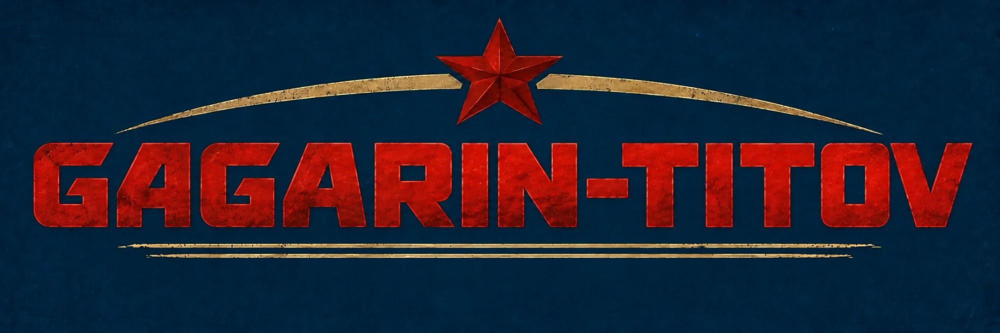
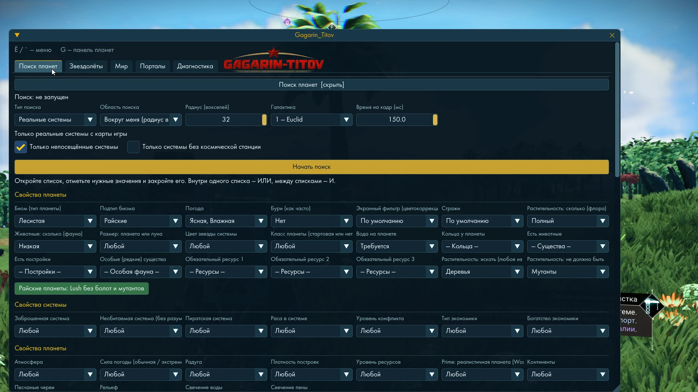
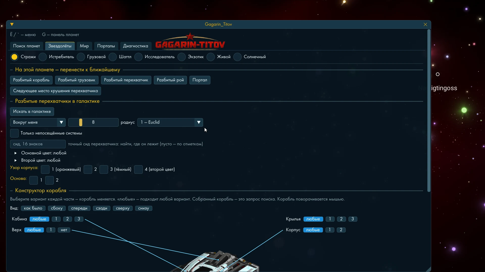
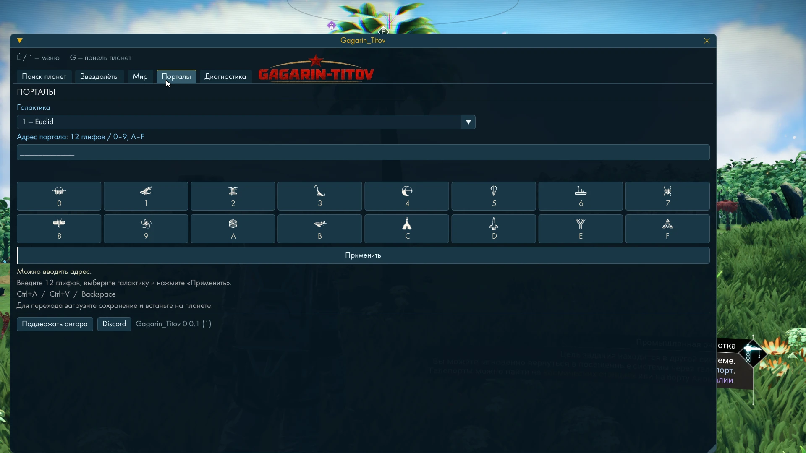

# Gagarin_Titov

**A No Man's Sky mod with an in-game menu** for searching planets and ships across the galaxy, teleporting by address, placing any part anywhere, and changing the game's developer options. The interface is available in all 17 game languages. Free.

English · [Русский](README.ru.md)

**Mod version:** 0.0.3 · **Game version:** No Man's Sky 4228 (Steam, Windows)

## What's new in 0.0.3

- **Mouse and keyboard handling in the menu.** Fixed the cursor snapping to the center during flight and accidental keyboard input into menu fields.

## What's new in 0.0.2

- **Menu and warp on NVIDIA graphics cards.** On some NVIDIA/DLSS systems, the menu would not open with `Ё`/`~` and warp would not activate with `X`; both now work.
- **Keys are hooked as soon as the game starts**, independently of the menu, so warp from the Discoveries menu works reliably.
- Shorter logs that focus on the information needed to diagnose problems.

If you are upgrading from 0.0.1, you do not need to do anything: the mod updates itself when the game starts. The new version takes effect the next time you launch the game.

## Download and install

**Download one file:** **`Gagarin_Titov_0.0.3.zip`** (5.22 MB) from the [**Releases**](../../releases/latest) page, in the release's **Assets** section. The “Source code” files are not the mod; GitHub adds them automatically.

**The archive contains:**

```
Gagarin_Titov_0.0.3.zip
├── Binaries\winmm.dll          ← the mod (one file)
├── GAMEDATA\Gagarin\           ← ship catalog and part icons for the menu
└── Gagarin_Titov\              ← this guide and font license (not needed by the game)
```

**Install in 5 steps:**

1. **Close the game.**
2. **Open the game folder:** in Steam, go to Library → right-click **No Man's Sky** → **Manage** → **Browse local files**. The folder usually looks like `C:\Program Files (x86)\Steam\steamapps\common\No Man's Sky\` and contains `Binaries` and `GAMEDATA`.
3. **Open** `Gagarin_Titov_0.0.3.zip`, select everything inside (`Binaries`, `GAMEDATA`, and `Gagarin_Titov`), and **drag it into the No Man's Sky folder** from step 2—the folder that contains `Binaries` and `GAMEDATA`.
   - Do not copy the files *inside* `Binaries` or `GAMEDATA`; copy the three folders into the main `No Man's Sky` folder.
   - If Windows asks whether to merge folders or replace files, choose **Yes/Replace**. The game's own files are not changed; this only adds the mod files.

   The result should look like this:

   ```
   No Man's Sky\                       ← copy the folders here
   ├── Binaries\
   │   ├── NMS.exe                     (already part of the game)
   │   └── winmm.dll                   ← mod file
   ├── GAMEDATA\
   │   ├── PCBANKS\                    (already part of the game)
   │   └── Gagarin\                    ← mod data
   │       ├── ships\catalog.txt, icons.bin
   │       └── parts\icons.bin
   └── Gagarin_Titov\                  ← guide; can be deleted
   ```
4. **Check:** `winmm.dll` is in `No Man's Sky\Binaries\`, next to `NMS.exe`.
5. **Start the game**, load a save, and press **`Ё`** (or `~` on an English keyboard) to open **Gagarin_Titov**. Press **`G`** for the planet table.

**Uninstall:** delete `No Man's Sky\Binaries\winmm.dll`. You can also delete `GAMEDATA\Gagarin`, which contains the mod's settings and logs. The game and saves are not changed.

---

## Screenshots

All screenshots were taken in the game.

**Planet search** — planet and system properties, plus one-click Paradise planet filters:



**Starships** — travel to crashed ships on a planet, Sentinel interceptors across the galaxy, and a ship builder:



**Portals** — 12 glyphs, galaxy selection, and Apply:



---

## Features

Open the menu with **`Ё`** (`~`); open the current system's planet table with **`G`**.

### Planet search

- Searches systems across the galaxy with **the game's own procedural generator**—without flying or loading worlds.
- Filters include biome and subtype, weather and storms, Sentinels, water and clarity, flora and fauna, resources, Paradise planets, planet size, rings, star type, economy, race and conflict level, creature conditions, and vegetation (trees, mushrooms, cacti, corals, and more).
- Filter water, grass, plant, leaf, and sky colors by groups (blue, green, light, dark, etc.) or an exact sample.
- Search the current system, nearby space, or the whole galaxy. Results are saved, and you can teleport to any planet with one click.
- A summary explains why planets were rejected and which filter ruled out the most.

### Starships

- Search ships by parts and colors: fighters, haulers, shuttles, explorers, exotics, living ships, solar ships, Sentinel interceptors, and freighters.
- **Build a ship from parts:** choose a variant for each part and see the ship update on screen. The assembled ship becomes the search query. Rotate it with the mouse or use preset views.
- **Find seeds by appearance** across all CPU cores; see how rare the selected appearance is.
- **Crashed Sentinel interceptors across the galaxy:** find one and teleport to its crash site.
- **“On this planet”:** travel to the nearest crashed ship, freighter, interceptor, swarm, or portal.

### World

- **Time of day:** Auto day and Auto night.
- **Game developer options** are the game's own flags and can be toggled with checkboxes:
  - Immortality; no player damage; infinite stamina.
  - Everything is free (building and purchases); bases do not need power.
  - Galaxy map warps without fuel or the required drive.
  - Repeat simple interactions; buttons work without being held.
  - Move bases from the base terminal; save on derelict freighters; missions without the required rank.
  - Reveal the system map; remove clouds; stop the day/night cycle; hide the game HUD for screenshots.
- **Place any part:** use parts missing from the normal build menu, including station, freighter, Corvette, and hidden parts. Browse an illustrated catalog or search by name. Hidden parts can also be shown in the game's build menu.
- **Part scaling:** place parts at any size.
- **Remove placement restrictions:** including “Too close to ship” and the portal converter.
- **All parts everywhere:** base, Corvette, freighter, and station.
- **Higher building limits.**
- **Warp from Discoveries:** a “Teleport” row appears on a planet's Discoveries page. Use `X` (rebindable) or `Y` on a gamepad.
- **Galactic scanner** reveals all planets in the current system. **Scan planet** reveals nearby plants, minerals, and animals and grants the same reward as a visor scan.
- **Menu language:** choose any of the game's 17 languages; changes apply immediately.

### Portals

Enter 12 glyphs, choose a galaxy by number or name, select **Apply**, and travel to the destination.

### Planet table (`G`)

A bar at the top of the screen shows every planet in the system: name, biome, weather, Sentinels, water, resources, color samples, and sky colors by day, dusk, and night.

---

## Important information

### Performance and slowdowns

The mod runs inside the game and shares the CPU with it. Its impact—from a fraction of a second to more—**depends on your computer**. Planet searches, ship seed searches (which use all CPU cores), and scanners are the heaviest tasks. While they run, the game **may slow down**, with lower frame rates or stutters. When a search finishes or you press **Stop**, performance returns to normal. On slower computers, search a smaller area (the current system or nearby space) instead of the whole galaxy.

Planet search has a **Time per frame (ms)** slider that controls how much of each game frame is given to the search (0.25–150 ms; default 2). Higher values make searches faster but can slow the game more; lower values keep the game smoother but take longer. If the game stutters, lower the value.

### Saves

**Place any part**, **All parts everywhere**, and **Remove placement restrictions** change what the game writes to your save. **Back up your save folder before trying them:**

```
%APPDATA%\HelloGames\NMS
```

It is your playtime—keeping an extra copy is a good idea.

### Multiplayer

By default, features also work in multiplayer. The **Only with Multiplayer off** checkbox on the World tab disables game-changing features while Multiplayer is on. Please be considerate of other players.

### Game updates

The mod is tied to a game version. After No Man's Sky updates, it checks `NMS.exe` and **does not activate** if the version is unsupported; the game itself continues to work normally. A mod update for the new game version will be published here.

### Auto-update

When the game starts, the mod checks this repository for a newer version and downloads `winmm.dll`, verifying its size and checksum. The update takes effect the next time the game starts. Disable auto-update with the checkbox on the World tab.

### Antivirus warnings

The game loads the mod as a DLL. Some antivirus programs flag files loaded this way by mods. To verify that your download matches the published file, check its checksum.

---

## Verify the file

Checksums for all files are in `SHA256SUMS.txt`. To check your copy in PowerShell:

```powershell
Get-FileHash "C:\Program Files (x86)\Steam\steamapps\common\No Man's Sky\Binaries\winmm.dll" -Algorithm SHA256
```

The result should match the `winmm.dll` line in `SHA256SUMS.txt`.

---

## How it works

When the game starts, it loads `winmm.dll`. Gagarin_Titov forwards all 181 functions to the system `winmm.dll` in `Windows\System32` without changing them—so game audio and timers work as usual—and starts the menu on a separate thread.

- Settings: `No Man's Sky\GAMEDATA\Gagarin\settings.txt`
- Logs: `No Man's Sky\GAMEDATA\Gagarin\logs\`

---

## Need help?

Tell me what you did, what you expected, and what happened. The game version, menu language, and latest log from `GAMEDATA\Gagarin\logs\` are helpful.

- Discord: [autoeme](https://discord.com/users/683764720821600301)
- Nexus Mods: [GAGARIN NMS](https://www.nexusmods.com/nomanssky/mods/4359)
- GitHub: [autoeme](https://github.com/autoeme)

The in-game menu also has **Support** and **Discord** buttons at the bottom.

**Support the author:** [DonationAlerts](https://www.donationalerts.com/r/autoeme)

---

This mod is free and made by one person. No Man's Sky, its assets, names, and font belong to Hello Games. The mod displays and uses data already present in your copy of the game. The menu font is NMS Futura Pro Book from the game; see `NMS-Font-LICENSE.txt` and `NMS-Font-source.json` for the license and source.
